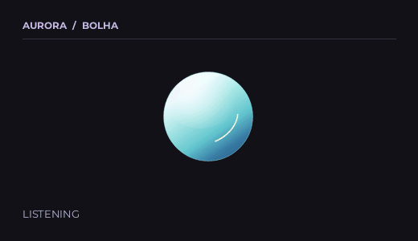
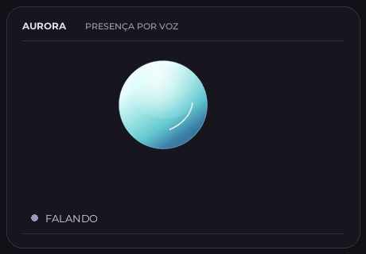
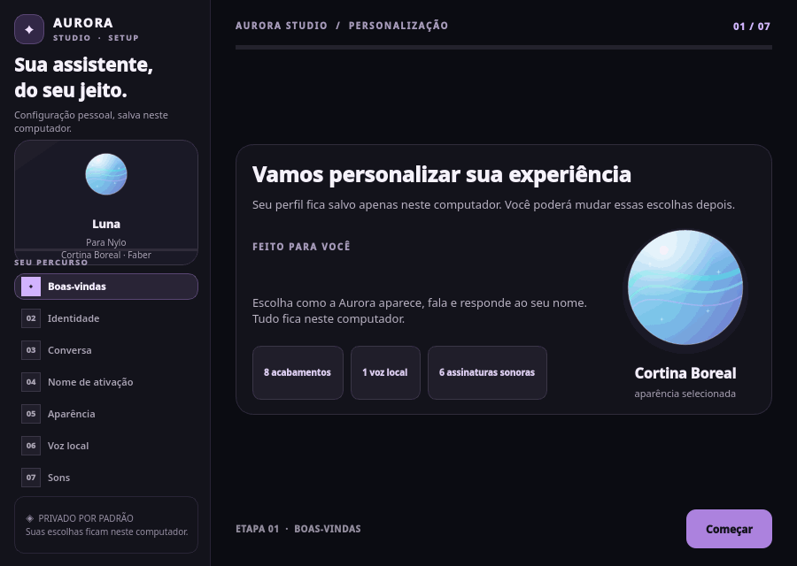
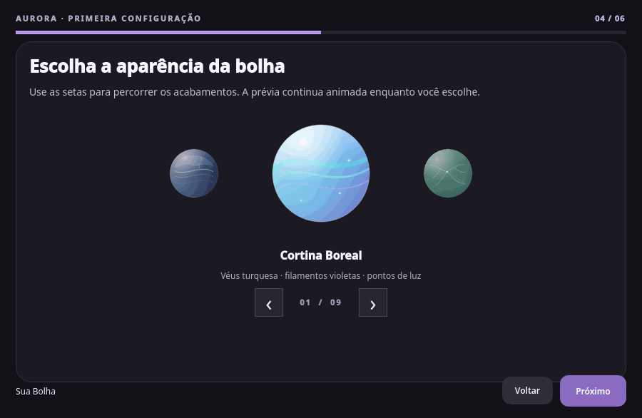
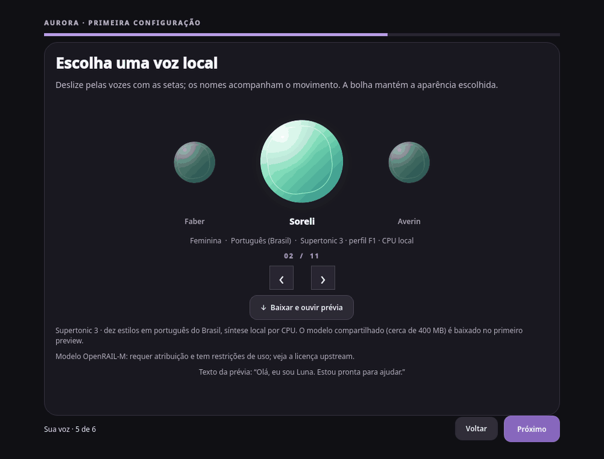
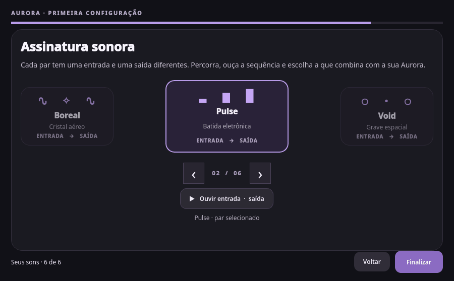

# Aurora Project

**Versão:** `3.2.0-beta.1` · **Canal:** Pré-release beta · **Codinome:** `Callisto Persona Studio` · **Build:** `aurora-project-3.2.0-beta.1-callisto-persona-studio`

**Uma assistente de voz para Linux, com uma presença pequena na tela e o processamento principal no próprio computador.** A Aurora desperta por voz, entende pedidos cotidianos, conversa em uma sessão contínua e pode pesquisar na web ou executar ações locais.

  
  

## Site oficial

Explore a Aurora em uma apresentação interativa, com carrossel de aparências, demonstrações animadas e informações do projeto: [nylofofin.github.io/Aurora](https://nylofofin.github.io/Aurora/).

## Veja a Aurora

A esfera mantém o formato circular e muda de cor, luz, refração e detalhes conforme o estilo escolhido. As oito aparências têm assinaturas próprias: Cortina Boreal, Gelo Fraturado, Tempestade Âmbar, Órbita Índigo, Eclipse Rosé, Falha Prismática, Névoa Violeta e Calota Glacial. A Órbita Índigo tem um satélite que percorre um anel inclinado; as outras aparências usam fenômenos de superfície diferentes. O site e a prancha usam imagens exportadas pelo renderer oficial do onboarding.

O Aurora Studio deixa configurar nome, personalidade, tom, nível de detalhe, preferências de resposta, palavra de ativação, aparência, voz e assinatura sonora. As escolhas montam uma camada de estilo limitada dentro do prompt local da assistente; não alteram permissões nem regras de segurança. O treinamento de um nome personalizado aparece quando necessário.

As animações abaixo foram capturadas dos próprios componentes do onboarding: a troca de páginas desliza, e as escolhas percorrem os carrosséis com o mesmo movimento usado na configuração.

### Conheça o Aurora Studio

### Escolha da bolha

### Escolha da voz

### Escolha dos sons

## O que ela faz

- Ativação e transcrição de fala locais com Vosk e Whisper.cpp.
- Conversa local com Ollama e síntese local com Piper usando a voz Faber.
- Pesquisa web quando pedida, com fontes reunidas em um resumo.
- Ações no desktop e rotinas locais, com confirmação antes de operações que alteram o sistema.
- Perfil, nome de ativação, aparência, voz, sons e dados de uso mantidos no computador.

A pesquisa web precisa de internet. O modelo Whisper e os pesos Piper são baixados quando necessários e têm licenças próprias. Consulte os detalhes da [voz local](assets/voices/README.md) e das [fontes dos sons](assets/audio/SOURCES.md).

## Instalação

A versão gráfica é voltada ao **Fedora Workstation com GNOME em Wayland**. Baixe o RPM do Aurora Studio na página de [Releases](https://github.com/Nylofofin/Aurora/releases/latest), abra-o pelo GNOME Software e siga as etapas apresentadas. O Studio verifica o ambiente, instala ou atualiza a Aurora e permite revisar as preferências do usuário.

Instruções de empacotamento e instalação manual estão em [`packaging/rpm/README.md`](packaging/rpm/README.md). Outros ambientes Linux ainda não são oficialmente suportados.

## Privacidade e segurança

Áudio, transcrição, inferência, síntese de voz e perfil são processados localmente. Quando você pede uma pesquisa, o texto da consulta é enviado a serviços web para obter resultados; o áudio não é enviado. Os modelos de linguagem, Whisper e Piper são baixados quando necessários. Ações que alteram o sistema pedem confirmação. Pesos de modelos não são incluídos no repositório ou no RPM.

## Aurora Project e licença

Aurora é um projeto independente, conduzido por **Nylofofin**. O código e a documentação foram gerados por IA. O mantenedor conduz as decisões, a integração e os testes.

O código próprio é licenciado sob **GNU GPL-3.0-only**. Modelos, dependências e outros materiais mantêm as licenças de seus autores. Leia [`LICENSE`](LICENSE) antes de redistribuir.

[Releases](https://github.com/Nylofofin/Aurora/releases) · [Código-fonte](https://github.com/Nylofofin/Aurora) · [Licença](LICENSE)
